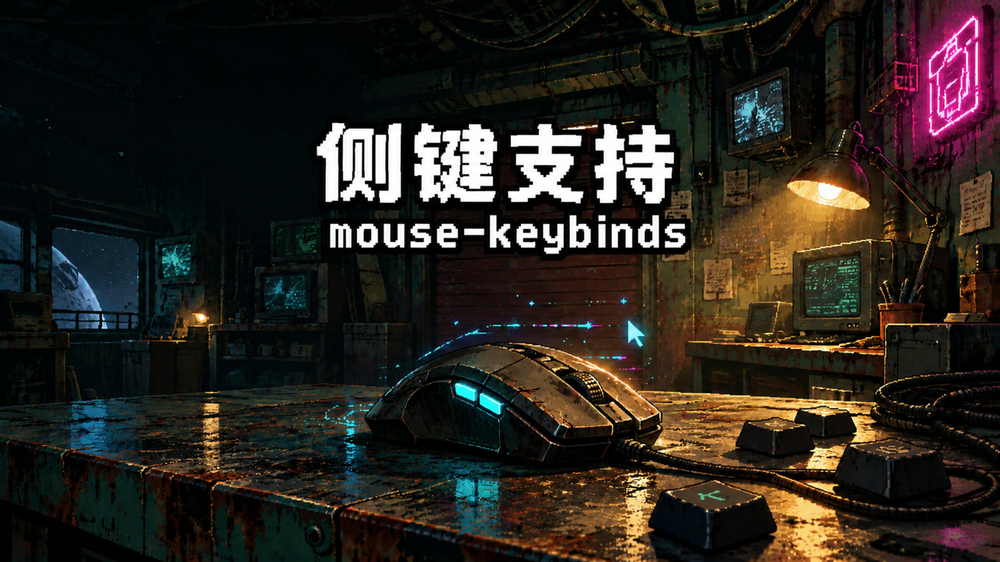

# Mouse Keybinds

[中文说明](README.zh-CN.md) · [Steam Workshop](https://steamcommunity.com/sharedfiles/filedetails/?id=3829349177)

Bind **mouse side buttons** in Probably Stolen's vanilla key rebinding UI and the Storage Coordinator presets — and fix the intermittent scroll-to-rotate failure while dragging items.



## Features

- **Side button capture** — side buttons 1–4 (Unity `Mouse3`–`Mouse6`) can be bound to any of the 22 rebindable actions in Settings → Key Bindings, and to Storage Coordinator preset hotkeys. Bindings persist with the save file. Buttons 1–2 are the standard forward/back buttons; buttons 3–4 depend on the mouse exposing extra buttons as standard mouse buttons (see Compatibility).
- **Localized key names** — Key names follow the game language (zh / en / ru / es / fr / de / pl / ja), falling back to English.
- **Scroll-to-rotate fallback** — Hold `LeftAlt` while dragging and scroll to rotate, even for stacked items (steel sheets, coins, fuel cells) that normally change quantity on scroll. Also self-heals a stuck state flag that can disable scrolling entirely.
- **Key conflict dialog** — When binding a key that is already in use, a dialog lists every conflicting function (rebindable actions / Storage Coordinator presets / hidden scene keys) and asks what to do: allow one key for multiple actions, or cancel. Check "don't ask again" to bind silently; re-enable anytime in the mod settings.
- **Cleaner mod panel** — Hides the native "Developer mode" toggle from the local mod detail page.

## Install

**Steam Workshop:** subscribe, enable in the in-game Mods (改装件) panel, restart the game.

**Manual:** copy the `mouse_keybinds` folder into `Probably Stolen/Mods/`, enable in-game, restart.

## Usage

1. Open **Settings → Key Bindings**.
2. Click any binding, then press a mouse side button (1–4) — the button shows the localized name.
3. Play. Bindings are stored in the save file (`ES3`) and survive restarts.

## Configuration

In-game mod settings (stored at `ModConfigs/mouse_keybinds.json`):

| Key | Default | Description |
|---|---|---|
| `ScrollRotateModifier` | `LeftAlt` | Hold this key + scroll while dragging to force rotation. `None` restores vanilla behavior. |
| `ConflictPrompt` | `true` | Confirm dialog when binding a key already in use; turn off to allow conflicts silently. |
| `VerboseLog` | `false` | Log side-button captures and drag diagnostics. |

## Compatibility

- **Game version:** 0.46D (1.0)
- Uses the game's built-in official ModLoader + Harmony. No reflection, no extra capabilities, no save-format changes.
- Coexists with other keybind mods (e.g. *BackspaceClear* patches a different phase of the same method).
- **Not supported:** left / right / middle mouse buttons, and anything beyond `Mouse6` (not visible to the engine). Note: many multi-button mice (e.g. Logitech G502 G6/G7/G8) consume their extra buttons in the driver and never send them to the OS — map such buttons to keyboard keys in your mouse driver.
- **Uninstalling:** bindings you made with this mod keep working after it is removed, but they can no longer be re-recorded as mouse buttons. Overwrite them with any keyboard key in Settings → Key Bindings.

## Build

Requires .NET SDK and the game's managed assemblies.

```bash
dotnet build src/MouseKeybinds.csproj -c Release -p:GameDir="<path to Probably Stolen>"
```

Deploy: `bash deploy.sh` (set `GAME_DIR` to override the default path).

## License

[MIT](LICENSE)
