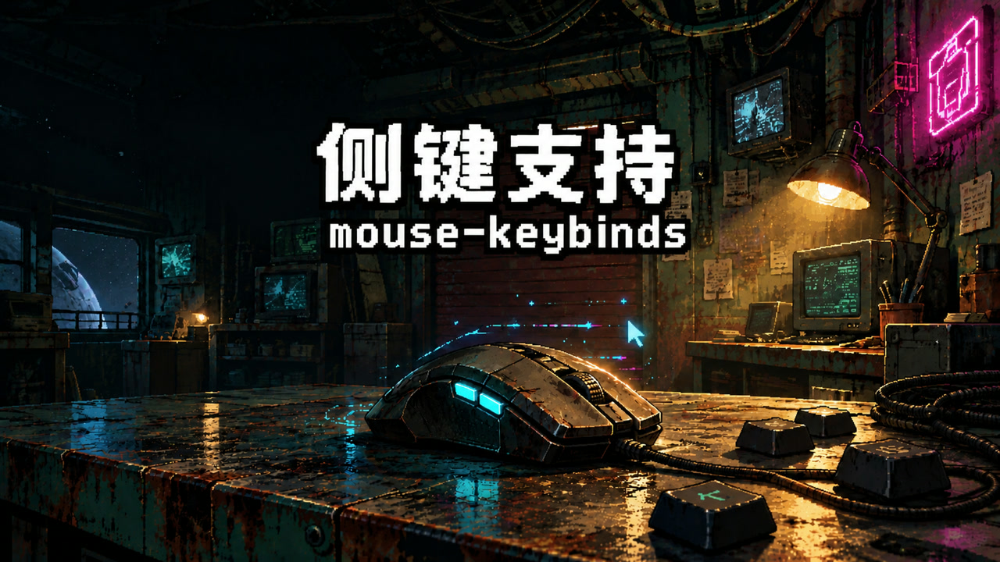

# 鼠标键位支持（Mouse Keybinds）

[English](README.md) · [Steam 创意工坊](https://steamcommunity.com/sharedfiles/filedetails/?id=3829349177)

为《深空当铺：可能是偷的》**储物协调器的容器预设**补上**鼠标侧键**录入，并修复拖拽物品时滚轮旋转偶尔失效的问题。

> 游戏自 1.0.0.x 起，「设置 → 按键绑定」界面已原生支持录入鼠标键，因此本 Mod 从 v1.3.0 起不再接管该界面，只保留储物协调器预设这一处原生仍只收键盘键的地方。



## 功能

- **协调器预设侧键** —— 储物协调器的容器预设快捷键可绑定侧键 1~4（Unity `Mouse3`~`Mouse6`），随存档持久化。侧键 1~2 即标准「前进 / 后退」键，所有鼠标都有；侧键 3~4 依赖鼠标是否把额外按键以标准鼠标键发出（见下方「不支持」说明）。
- **键名跟随语言** —— 键名自动匹配游戏语言（简中 / 英 / 俄 / 西 / 法 / 德 / 波 / 日），缺条目回退英文。
- **冲突提醒（两处）** —— 在「设置 → 按键绑定」或储物协调器预设里录入一个已被占用的按键时（其他键位 / 预设 / 隐藏场景键位），弹窗列出全部冲突项供确认：可一键多功能，取消则不写入（协调器会还原旧键值）；可勾选「以后不再提示」，随时在 Mod 设置重开。
- **滚轮旋转兜底** —— 拖拽时按住 `LeftAlt` 滚动滚轮即可旋转，堆叠物品（钢板、硬币、燃料电池等原本滚轮调数量的物品）同样生效；同时自动修复旧版本会导致滚轮持续失效的卡死状态。
- **面板清理** —— 隐藏本地 Mod 详情页原生的「开发者模式」开关。

## 安装

**创意工坊：** 订阅 → 游戏内「改装件」面板启用 → 重启游戏。

**手动：** 把 `mouse_keybinds` 文件夹放进 `Probably Stolen/Mods/`，游戏内启用后重启。

## 使用

1. 建造或走到**储物协调器**前，打开它的容器界面。
2. 新建（或选中）一个容器预设，点击快捷键录入。
3. 按下鼠标侧键（侧键 1~4）—— 输入框会显示当前语言下的键名。
4. 保存后生效，随存档持久化。

改键位请在游戏原生「设置 → 按键绑定」里操作——那里已经原生支持鼠标键；出现按键冲突时仍会弹出本 Mod 的确认窗。

## 配置

游戏内 Mod 设置（落盘于 `ModConfigs/mouse_keybinds.json`）：

| 配置项 | 默认值 | 说明 |
|---|---|---|
| `ScrollRotateModifier` | `LeftAlt` | 拖拽时按住该键滚动滚轮强制旋转；选 `None` 恢复原版行为 |
| `ConflictPrompt` | `true` | 协调器预设录入冲突按键时弹窗提醒；关闭后冲突直接允许 |
| `VerboseLog` | `false` | 记录预设录入与拖拽诊断日志 |

## 兼容性

- **适配游戏版本：** 1.0.0.x（已在 1.0.0.13 公开正式版与 1.0.0.16 测试版上验证）
- 基于游戏自带的官方 ModLoader + Harmony，不声明额外能力、不修改存档格式。
- 可与其他改键类 Mod 共存（例如 *退格清空改键* 补的是原生改键方法的另一个阶段）。
- **不支持：** 鼠标左键 / 右键 / 中键，以及 `Mouse6` 之后的按键（引擎接收不到）。注意：许多多侧键鼠标（如罗技 G502 的 G6/G7/G8）的额外按键被驱动程序直接消费，不作为鼠标键发给系统，此类按键需在驱动里映射为键盘键。
- **卸载说明：** 绑在协调器预设上的侧键在卸载后仍然生效，但无法再录入新的鼠标键（协调器自己的白名单只收键盘键）。在预设录入界面按任意键盘键即可覆盖。

## 构建

需要 .NET SDK 与游戏托管程序集。

```bash
dotnet build src/MouseKeybinds.csproj -c Release -p:GameDir="<游戏目录>"
```

部署：`bash deploy.sh`（可用 `GAME_DIR` 环境变量覆盖默认路径）。

## 许可

[MIT](LICENSE)
