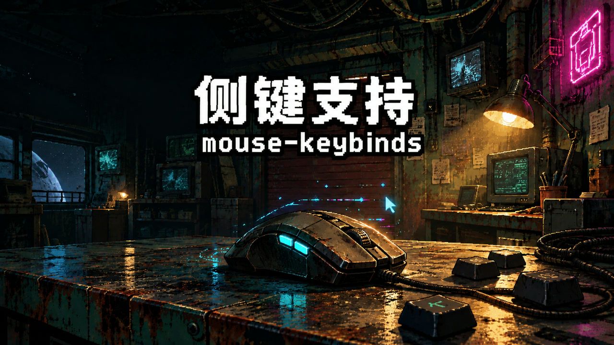

# 鼠标键位支持（Mouse Keybinds）

[English](README.md) · [Steam 创意工坊](https://steamcommunity.com/sharedfiles/filedetails/?id=3829349177)

让《深空当铺：可能是偷的》原生的改键界面与储物协调器容器预设支持**鼠标侧键**，并修复拖拽物品时滚轮旋转偶尔失效的问题。



## 功能

- **侧键录入** —— 侧键 1~4（Unity `Mouse3`~`Mouse6`）可绑定到游戏全部 22 个可改键位（旋转 / 翻转 / 丢弃 / 快捷移动 / 工具箱槽位等）以及储物协调器的预设快捷键，随存档持久化。侧键 1~2 即标准「前进 / 后退」键，所有鼠标都有；侧键 3~4 依赖鼠标是否把额外按键以标准鼠标键发出（见下方「不支持」说明）。
- **键名跟随语言** —— 键名自动匹配游戏语言（简中 / 英 / 俄 / 西 / 法 / 德 / 波 / 日），缺条目回退英文。
- **滚轮旋转兜底** —— 拖拽时按住 `LeftAlt` 滚动滚轮即可旋转，堆叠物品（钢板、硬币、燃料电池等原本滚轮调数量的物品）同样生效；同时自动修复会导致滚轮持续失效的卡死状态。
- **按键冲突弹窗** —— 录入已被其他功能使用的按键时，弹窗列出全部冲突功能（键位 / 储物协调器预设 / 隐藏场景键位三方互查）供确认：允许一键多功能，取消则不写入；可勾选「以后不再提示」，随时在 Mod 设置重开。
- **面板清理** —— 隐藏本地 Mod 详情页原生的「开发者模式」开关。

## 安装

**创意工坊：** 订阅 → 游戏内「改装件」面板启用 → 重启游戏。

**手动：** 把 `mouse_keybinds` 文件夹放进 `Probably Stolen/Mods/`，游戏内启用后重启。

## 使用

1. 打开 **设置 → 按键绑定**。
2. 点击任意一项，按下鼠标侧键（侧键 1~4）—— 按钮会显示当前语言下的键名。
3. 绑定会写入存档（ES3），重启后保持。

## 配置

游戏内 Mod 设置（落盘于 `ModConfigs/mouse_keybinds.json`）：

| 配置项 | 默认值 | 说明 |
|---|---|---|
| `ScrollRotateModifier` | `LeftAlt` | 拖拽时按住该键滚动滚轮强制旋转；选 `None` 恢复原版行为 |
| `ConflictPrompt` | `true` | 录入冲突按键时弹窗确认；关闭后冲突直接允许 |
| `VerboseLog` | `false` | 记录侧键录入与拖拽诊断日志 |

## 兼容性

- **适配游戏版本：** 0.46D（1.0）
- 基于游戏自带的官方 ModLoader + Harmony，不使用反射、不申请额外权限、不修改存档格式。
- 可与其他改键类 Mod 共存（例如 *退格清空改键* 补的是同一方法的另一个阶段）。
- **不支持：** 鼠标左键 / 右键 / 中键，以及 `Mouse6` 之后的按键（引擎接收不到）。注意：许多多侧键鼠标（如罗技 G502 的 G6/G7/G8）的额外按键被驱动程序直接消费，不作为鼠标键发给系统，此类按键需在驱动里映射为键盘键。
- **卸载说明：** 用本 Mod 绑定的侧键在卸载后仍然生效，但无法再录入新的鼠标键。在「设置 → 按键绑定」里按任意键盘键即可覆盖。

## 构建

需要 .NET SDK 与游戏托管程序集。

```bash
dotnet build src/MouseKeybinds.csproj -c Release -p:GameDir="<游戏目录>"
```

部署：`bash deploy.sh`（可用 `GAME_DIR` 环境变量覆盖默认路径）。

## 许可

[MIT](LICENSE)
